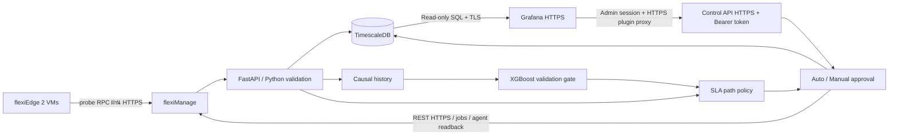

# รายละเอียดการ implement

วันที่เริ่ม: 1 ตุลาคม 2026 · workspace: `E:\Proposal\AI_SD-WAN`

## ผลลัพธ์และ stack ปัจจุบัน

รัน flexiManage 6.3.37 กับ flexiEdge 6.3.35 สอง KVM VMs ใน WSL และสาม IPsec tunnels แล้ว มี live probes, REST policy apply/jobs/agent readback และ packet experiments แยกจาก simulator

วันที่ 2 ตุลาคม 2026 ย้าย backend storage เป็น TimescaleDB 2.30.2 / PostgreSQL 17 และ monitoring เป็น Grafana 13.2.3 ตาม stack ของผู้ใช้ FastAPI/Python เป็น telemetry/decision service, XGBoost เป็น forecasting module, controller integration ใช้ REST/HTTPS และฐานข้อมูลใช้ parameterized SQL ผ่าน psycopg/TLS ดู [รายงาน migration](../reports/flexiwan/STACK_MIGRATION.md)

MongoDB/Redis เป็น dependencies ภายใน flexiManage upstream ยังต้องคงไว้ ส่วน Python service และ Grafana ใช้ PostgreSQL; Grafana metadata database ใช้ PostgreSQL เช่นเดียวกัน

## โครงสร้างระบบ

Live ML ปิดจน validate ข้อมูลจริง ไม่มีการเปลี่ยน synthetic weights หรือเกณฑ์ SLA ใน migration รอบนี้ Simulator/DryRunAdapter ยังใช้ทดสอบ policy และ offline evaluation ได้

| ไฟล์ | หน้าที่ |
|---|---|
| `sdwan/domain.py` | Telemetry schema, units, 3 WAN และ SLA profiles |
| `sdwan/features.py`, `sdwan/model.py` | Causal features, XGBoost train/validation/load/predict |
| `sdwan/policy.py`, `sdwan/service.py` | Decision, recommendations, approval และ serialized apply |
| `sdwan/storage.py` | TimescaleDB hypertable, SQL events/state, history และ JSON audit export |
| `sdwan/flexiwan.py`, `sdwan/adapters.py` | REST contract, TLS, jobs/readback และ durable apply journal |
| `sdwan/collector.py` | Probe จริงผ่าน flexiManage → flexiEdge RPC |
| `sdwan/api.py`, `sdwan/cli.py` | HTTPS control API, HTTP Bearer authorization และ CLI |
| `sdwan/openapi_assets/` | Swagger UI ที่ self-host สำหรับ API documentation |
| `lab/observability.compose.yaml`, `lab/grafana/` | TimescaleDB/Grafana, read-only SQL และ authenticated control panel |
| `scripts/prepare_observability.py`, `scripts/migrate_telemetry.py` | Runtime secrets/TLS และ verified legacy import |
| `scripts/verify_stack.py` | HTTPS/SQL/controller/agent/LAN readback โดยไม่เปลี่ยน policy |
| `lab/run_live_eval.py` | Per-trial TimescaleDB streams, UDP observations, PCAP และ audit export |
| `sdwan/simulator.py`, `sdwan/evaluation.py`, `sdwan/reporting.py` | Offline evaluation และ frozen report analysis |

## Storage และ monitoring

`telemetry` เป็น hypertable แบ่งเวลา 1 วัน พร้อม typed metric columns และ JSONB payload ที่เก็บ raw timestamps เดิม `events`/`state` เป็น PostgreSQL tables ทุกตารางแยกด้วย stream; live ใช้ `live`, แต่ละ experiment ใช้ stream ใหม่ ไม่มี SQLite runtime fallback

ย้ายข้อมูลเดิม 6,384 telemetry, 2,287 events, 2 state โดยอ่าน SQLite ต้นทางอย่างเดียวและเทียบ canonical content SHA-256 เท่ากัน เก็บฐานข้อมูลเก่าเป็นสำรองและไม่แก้ frozen SQLite audit ของ experiments เดิม

Grafana datasource ใช้ `sdwan_reader` ที่มี SELECT และไม่มี INSERT; database connections ใช้ `sslmode=verify-full` มี WAN health/freshness, latency/jitter/loss/utilization, mode/priority/ML status, pending recommendation, heartbeat และ audit log รวม 15 panels **Control and approvals** เป็น native panel เปลี่ยน Auto/Manual, profile และ Approve/Reject ผ่าน HTTPS app proxy ได้ใน Dashboard ใช้ Grafana session; proxy routes สำหรับเขียนกำหนด `reqRole=Admin` ส่วน Viewer อ่าน state ได้ API token เก็บใน encrypted `secureJsonData` และเติมฝั่งเซิร์ฟเวอร์ ไม่ใส่ใน dashboard หรือ JavaScript

Grafana ใช้ native Linux host networking แต่ bind เฉพาะ `127.0.0.1:3000` เพื่อเข้าถึง API ที่ bind loopback ใช้ CA เดิมตรวจ HTTPS และ map TimescaleDB hostname ไป loopback PostgreSQL ไม่มีการปิด TLS verification หรือ HTML sanitization อนุญาต unsigned เฉพาะ plugin IDs สองตัวของ lab ดู [control plugin](../lab/grafana/control-plugin/README.md)

## Catalogue และ reporting v2

ใช้ `sdwan/scenarios.py` เป็นนิยามร่วม มี38 balanced cases:8availabilityรวมCONTROL,15quality,3stability,6mixed,6telemetry เพิ่ม targetWAN2/WAN3 และคง16 legacy fault IDs/trace semanticsเดิม รายงานคำนวณ denominatorจากmanifestและแยก5กลุ่ม; normalCONTROLและall-downไม่ถูกนับเป็นfault recovery

Defaultinitial priorityWAN1ยังคงเดิม จึงมีทั้งactive/standby handling cases การครอบคลุมaffected targetsไม่เท่ากับactive-path failoverทุกWAN Protocol, scopeและstaged live costอยู่ใน [EVALUATION_PROTOCOL](EVALUATION_PROTOCOL.md)

## ข้อมูลและ ML

รับ timestamp เป็น UNIX UTC seconds, latency/jitterเป็น ms, loss/utilizationเป็นเปอร์เซ็นต์ 0–100 และ link statusเป็น boolean จริง Reject unknown link/field, NaN/Infinity, rangeผิด, replay, future/stale timestamp และ duplicate linkใน batch โดยข้อมูลดีจาก WANอื่นยังเข้าระบบได้ ข้อมูลที่ถูก rejectไม่เติมเป็นค่า 0; sampleเดิมจะหมดอายุตาม freshness

Feature window 12 samples ที่ interval 5 วินาที: current, lag1, lag3, rolling mean/std และ slope ของแต่ละ metric พร้อม up/history fraction รวม 26 features หาก historyไม่ต่อเนื่องหรือไม่ครบ จะใช้ policyจากค่าปัจจุบันและไม่เรียก forecast

Targetคือ `metric(t+30s) − metric(t)`. ฝึก XGBoostด้วย `reg:absoluteerror`, depth3/5, early stoppingจาก validation แล้วบวกค่าปัจจุบันคืนตอน inference Targetไม่ได้ใช้ IDของscenarioหรือคำตอบว่าเส้นทางไหนดีที่สุด

แบ่ง training/validation ตาม episodeที่เรียงเวลา: 60/15 episodes ไม่มี history/labelข้าม boundary ผล validationของโมเดลที่ตรึงไว้:

| Metric | Raw XGBoost MAE | Persistence MAE | ใช้ XGBoost? |
|---|---:|---:|---|
| latency (ms) | 39.4440 | 42.8984 | ใช้ |
| jitter (ms) | 9.3849 | 10.3959 | ใช้ |
| loss (percentage points) | 2.6425 | 2.6798 | ไม่ใช้: improvementไม่ถึง 2% |
| utilization (percentage points) | 2.9888 | 3.6261 | ใช้ |

ใช้ XGBoostเมื่อ validation MAEดีขึ้น≥2%เท่านั้น ไม่เปลี่ยน gateตามผล final test ดูค่าบน final held-out tracesใน `reports/latest/EVALUATION.md` เพราะ validationเป็นชุดเลือกโมเดล ไม่ใช่หลักฐานสุดท้ายว่าทำนายสภาพจริงได้ดี

## Path selection

1. ตัดลิงก์ down และ telemetryอายุเกิน 10 วินาทีออก
2. สำหรับ reactive/AI ถ้ามีเส้นทางที่ผ่าน SLAปัจจุบัน ให้พิจารณาเส้นทางกลุ่มนั้นก่อน; forecastไม่สามารถผลักให้เลือก pathที่ผิด SLAแทน pathที่ดี
3. คำนวณ scoreจาก metric/SLA ratio ด้วย weights latency=.30, jitter=.20, loss=.35, utilization=.15, SLA violation penaltyและcapacity penalty
4. AIเพิ่ม penaltyจาก forecastที่แย่ลงด้วย weight=.35; forecastที่ดีขึ้นไม่ใช้ลบปัญหาที่วัดได้จริง
5. down/staleปัจจุบัน → failoverทันที; SLAปัจจุบันเสียและมีhealthy alternative → เปลี่ยนทันที แม้ติด cooldown
6. การเปลี่ยนตาม qualityปกติต้อง improvement≥.15, ผ่าน 3 confirmationsที่มี sampleใหม่และห่างกัน≥5วินาที, cooldown30วินาที
7. ทุกลิงก์ใช้ไม่ได้ → no_path alert; ถ้าทุกลิงก์ upแต่ผิด SLA จะเลือก least-bad pathและติดธง degraded

Thresholdทั้งหมดเป็น lab configurationที่แก้ได้ ไม่ใช่ค่าที่พิสูจน์แล้วว่า optimal และยังไม่มี probability calibration/conformal prediction หรือ drift detectorที่ผ่านข้อมูลจริง

## Auto / Manual และ audit

Manualเป็น default: recommendationยังไม่เปลี่ยน confirmed path จน approve ต้องตรวจ mode, ID, อายุ≤30วินาที, source path, freshnessและtargetที่เหมาะสมอีกครั้งก่อน apply คำอนุมัติซ้ำ, คำอนุมัติเก่า, networkเปลี่ยน หรือ mode/profileเปลี่ยนจะไม่ apply

Autoเรียก adapterหลังผ่านpolicy ทั้งสอง modeบันทึก recommendation, decision, intent, approved/rejected, apply result และเวลาที่เกี่ยวข้อง หากadapterthrow exceptionหรือยังไม่ได้verify การเปลี่ยนจะไม่ advance confirmed path `DryRunAdapter`ตอบกลับเป็น simulated acknowledgementเสมอและระบุ backendไว้ทุกครั้ง ไม่มีการเรียก controllerจริง

ใน no_path confirmed pathหมายถึงค่าล่าสุดที่ยืนยัน ไม่ได้แปลว่าลิงก์นั้นยังให้บริการได้ ต้องอ่าน `network_available` และ decisionด้วย เมื่อ restartโหลด mode/profile/route/history แต่ไม่คืน pending recommendationเก่า

Control loopถูก serializeด้วยlockและมี watchdogทุก5วินาที จึงตรวจ staleได้แม้ไม่มีข้อมูลใหม่ Single-workerเป็นข้อจำกัดตั้งใจของprototype บังคับใช้ HTTPS และ API token เมื่อเริ่ม service รวม localhost และปฏิเสธ cross-origin access; ไม่เก็บ tokenลงbrowser storage

## สิ่งที่ eval บอกและสิ่งที่ยังไม่บอก

การผ่าน test cases เป็นผลของ **forecast + SLA rules + failover + freshness + guards** ร่วมกัน ไม่ใช่ classification accuracy16classes Baseline reactiveและlinearอาจผ่านเท่ากัน จึงต้องรายงานโดยตรง ไม่อ้างความเหนือกว่าจากการเอา AIเทียบกับpriorityที่อ่อนกว่าเพียงตัวเดียว

ผล simulation ยังไม่รวม feedbackจากtrafficหลังย้ายlink, shared-demandของหลาย applications, packet-levelfailover, session continuity, controller job delay หรือ native flexiWAN QBR ส่วน live runner ที่เพิ่มแยกต่างหากเตรียมวัด UDP RTT/loss/received throughput และ PCAP บนสองไซต์จริง มีผลที่ execute แล้วใน reports/flexiwan/CONTINUATION.md; ยังไม่ได้รันครบ legacy576 หรือ balanced1,368 trials

## flexiWAN integration ที่เพิ่มตามคำขอ

ใช้ flexiManage source/tag 6.3.37 จาก official GitLab และตรวจ `/spec` กับ OpenAPI ที่เก็บใน `contracts/` ก่อนเขียนทุกครั้ง ตัว adapter รับ access key จาก environment เท่านั้น ใช้ TLS verification และ policy/device allowlist แบบ exact set รวม pagination เพื่อไม่พลาด device ที่ใช้ policy เดียวกันในหน้าถัดไป

ก่อน PUT ตรวจ policy และ agent configuration ปัจจุบัน เก็บ snapshot/intent ใน journal พร้อม OS writer lock แล้วติดตามทุก job จน complete และอ่าน `get-device-config` ผ่าน controller ซ้ำ เปรียบเทียบทั้ง WAN action และ application classifier จึงคืน `verified=True` ชื่อ `confirmed_path` บน live หมายถึง **configured priority**; WAN ที่ส่งแพ็กเก็ตจริงต้องตรวจ PCAP แยก โดยเฉพาะ native failover/QBR

การ apply ใช้ background worker เดียว ทำให้ telemetry/UI ยังตอบสนองระหว่างรอ job Unknown outcome จะค้างเป็น unresolved และห้ามเขียนต่อ ไม่ retry PUT โดยเดา เมื่อ reconcile/rollback ต้องตรง config scope เดิม, queue ไม่ active และ remote policy ต้องตรง snapshot ที่ร้องขอ เพื่อไม่ทับการแก้ไขของผู้ดูแล

Live model ปิดเป็น default เพราะ train ด้วย synthetic metrics ที่ต่างจาก ICMP RTT/stddev probe บน VPP การเปิด forecast บน probe จริงถูกระบุเป็น experimental ทุก trial; ต้องเก็บ real training/validation/holdout ใหม่ก่อนอ้างประโยชน์ของ ML

Native QBR baseline ใช้ application classifier สำหรับ UDP ports 5209/5210/5211 และ service class real-time/low-latency/high-throughput ทั้ง native priority/reactive/AI ใช้ classifier เดียวกัน ส่วน QBR จัดสาม labels ใน tier เดียวแบบ link-quality และ AI service observe อย่างเดียว รายละเอียดและข้อจำกัดอยู่ใน [REAL_TESTBED.md](REAL_TESTBED.md)

## แหล่งอ้างอิงที่ตรวจระหว่าง implement

- [flexiWAN North Bound API](https://docsqa01.flexiwan.com/6.1.1/api/nbapi.html): การใช้ access key และ applyงานที่ต้องติดตาม job; ต้องตรวจ schemaกับเวอร์ชันlabอีกครั้ง
- [flexiWAN Path Selection](https://docsqa01.flexiwan.com/6.1.1/management/path-selection-policy.html): path labels, policy และ quality-based routing
- [XGBoost Python API](https://xgboost.readthedocs.io/en/stable/python/python_api.html): regressor, objective, early stoppingและmodel serialization
- [scikit-learn TimeSeriesSplit](https://scikit-learn.org/stable/modules/generated/sklearn.model_selection.TimeSeriesSplit.html): เหตุผลของ chronological evaluation; implementationนี้ใช้ episode separationที่ไม่ให้windowsข้าม boundary
- [FastAPI Security](https://fastapi.tiangolo.com/tutorial/security/first-steps/): HTTP bearer security interface; labใช้ tokenจากenvironmentและconstant-time comparison

แหล่งอ้างอิงสำหรับ stack migration: [TimescaleDB hypertables](https://docs.timescale.com/api/latest/hypertable/create_hypertable/), [Grafana PostgreSQL datasource](https://grafana.com/docs/grafana/latest/datasources/postgres/configure/), [Grafana provisioning](https://grafana.com/docs/grafana/latest/administration/provisioning/), [FastAPI local documentation assets](https://fastapi.tiangolo.com/how-to/custom-docs-ui-assets/).
