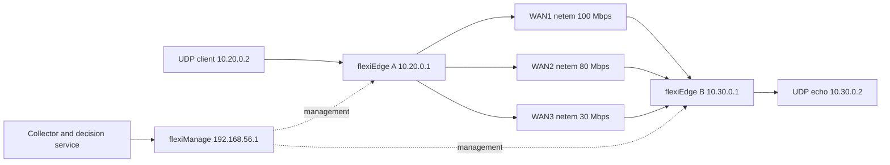

# flexiWAN lab และ live evaluation

รัน **flexiManage 6.3.37 จริง** ทั้ง native Windows รอบก่อนและ Docker ใน `AI-SDWAN-Lab` รอบปัจจุบันแล้ว หลัง restart Windows ยืนยัน VirtualMachinePlatform/WSL Enabled, HypervisorPresent=true และไม่มี servicing reboot pending Ubuntu 24.04 distro มี `/dev/kvm` และรัน flexiEdge 6.3.35 สองเครื่องผ่าน KVM พร้อม tunnel ครบ 3 เส้น, jobs/policy readback และ probe จริง

**ชุด S01 voice ล่าสุดผ่าน 12/12 actual packet trials**: สี่ strategies อย่างละสาม repeats หลังแก้ clock และใช้ tunnel timers1/4วินาที recovery2–4วินาที เกณฑ์ SLA เดิมไม่เปลี่ยน Reactive voice มี valid observations ครบ16 cases และ passing observations14/16: S07 แจ้ง no_path ครั้งแรกหลัง10.00วินาที เกินเกณฑ์5วินาที; S12 มี SLA97.14% ต่ำกว่า98% สอง initial attempts ที่ baseline invalid ถูกทดสอบซ้ำใน output แยกและผ่านทั้งคู่ ผลทั้งหมดรวม45 attempts,43 completed packet trials,40 valid,33 passed,5 invalid attempts ดู [CONTINUATION](../reports/flexiwan/CONTINUATION.md) ผล bring-up แรก5 trials (ผ่าน2 ไม่ผ่าน3) และทุกรอบ invalid ยังคงเก็บไว้ พร้อม UDP observations, PCAP, states และ audit ดู [LIVE_BRINGUP](../reports/flexiwan/LIVE_BRINGUP.md), [readiness ปัจจุบัน](../reports/flexiwan/wsl2-readiness.json) และ [verification ล่าสุด](../reports/flexiwan/continuation-verification.json) ยังไม่ได้รันเต็ม576 trials หรือ validate ML บนข้อมูลจริง ผล `reports/latest` ยังคงเป็น simulation

## Catalogue ปัจจุบัน

Balanced v2 มี38cases: availability8รวมCONTROL, quality15, stability3, mixed6, telemetry6 ครอบคลุม affected targetsทั้ง3WAN โดยคง initial priorityWAN1 ดู [EVALUATION_PROTOCOL](EVALUATION_PROTOCOL.md) และ [manifest](../reports/flexiwan/scenario-catalogue-balanced-20261002.json) Legacy16faultsยังเลือกด้วย `--suite legacy`; ผลด้านบนเป็น v1 ที่เก็บไว้

## เปิด Linux ให้พร้อม

บนเครื่องนี้ distro เฉพาะ lab คือ `AI-SDWAN-Lab`, Linux project อยู่ `/opt/ai-sdwan-lab` และ image/disk ของ distro อยู่ใน ignored `.work/wsl/` ใช้ Docker Engine ภายใน distro สำหรับ controller แยกจาก containers ของ Docker Desktop Linux service/VM ต้องมี WSL keepalive เพราะ systemd อย่างเดียวไม่รับประกันว่า distro จะคงเปิดเมื่อ shell ปิด

หลัง reboot ใช้ `.\scripts\start-wsl-lab.ps1` เพื่อเปิด keepalive แบบซ่อนและ resume network/namespace/controller/VM ที่มีอยู่ ตรวจ identity ก่อนทุก mutation; partial topology/stale bridges จะหยุดเพื่อให้ตรวจโดยไม่ลบ resources ตรวจ resume จาก WSL ที่หยุดแล้วสำเร็จเมื่อ 2 ตุลาคม 2026 แต่ยังไม่ได้ทำรอบ Windows cold reboot เพิ่มหลังสร้าง VMs หากต้องการเฉพาะ keepalive ใช้ `-KeepAliveOnly` รอ edge reconnect แล้วตรวจ preflight ก่อนเปิด service

Default Docker socket ถูก Docker Desktop redirect จึงให้ Engine 29.1.3 ของ lab ใช้ `unix:///run/ai-sdwan-docker.sock` ผ่าน systemd socket override เฉพาะ distro ที่เป็นเจ้าของ สคริปต์ resume เลือก endpoint นี้โดยตรง หากสั่ง Docker เองใน `AI-SDWAN-Lab` ให้ตั้ง `export DOCKER_HOST=unix:///run/ai-sdwan-docker.sock` ก่อนทุก compose command ดู [resume ปัจจุบัน](../reports/flexiwan/status-resume-20261002-final-verification.json) และ [ขั้นตอนหลัง restart](../reports/flexiwan/RESTART_RESUME.md)

หากตั้งเครื่องใหม่ที่ feature ยังปิดอยู่ เปิด PowerShell แบบ Administrator แล้วรัน:

```powershell
& 'E:\Proposal\AI_SD-WAN\scripts\enable-wsl2.ps1'
```

สคริปต์เปิด WSL/VirtualMachinePlatform และตั้ง hypervisor startup โดยไม่ reboot อัตโนมัติ ให้ restart Windows เมื่อสคริปต์รายงานว่าจำเป็น

แนะนำ isolated Ubuntu 24.04 Linux host ที่มี RAM ≥16 GB และพื้นที่สำหรับ images/PCAP ใช้ CPython 3.12 สำหรับ service และ Ubuntu 20.04 ภายใน edge VMs ตาม binary ที่ตรึง ถ้าไม่มี `/dev/kvm` generator จะใช้ QEMU TCG ซึ่งช้าและอาจทำให้ traffic generator/VPP ไม่ถึง load ที่ตั้งไว้ trial แบบนั้นต้องถูกนับเป็น invalid แทน pass ต้องตรวจ nested virtualization หากใช้ Linux host ภายใน WSL2/VM

คัดลอก project ไป Linux เช่น `/opt/ai-sdwan-lab` โดยไม่คัด private Windows credentials ลง repo แล้วเตรียม host:

```bash
cd /opt/ai-sdwan-lab
sudo touch .ai-sdwan-owned
sudo apt-get update
sudo apt-get install -y python3.12-venv git qemu-kvm libvirt-daemon-system libvirt-clients virtinst cloud-image-utils iproute2 tcpdump openssh-client curl
python3.12 -m venv .venv
.venv/bin/python -m pip install -r requirements-lock.txt
.venv/bin/python -m pip install -e '.[dev,lab]'
.venv/bin/python scripts/fetch_upstream.py
```

ติดตั้ง Docker Engine/Compose ตาม [เอกสารทางการ Ubuntu](https://docs.docker.com/engine/install/ubuntu/) บน host นี้ ตรวจว่า `sudo virsh list --all` และ `docker info` ทำงาน เลือก host ที่ไม่มี subnet `192.168.56.0/24`, `172.16.1.0/24`–`172.16.3.0/24`, `10.20.0.0/24`, `10.30.0.0/24` ชนกับเครือข่ายเดิม

## Topology และ controller



มี libvirt networks 9 ชุด: management NAT, LAN 2 ชุด, WAN 3 เส้น × 2 ฝั่ง แต่ละ WAN เชื่อมผ่าน namespace bridge `sdw-wan1/2/3` แยกจาก management VM มี NIC 5 ใบพร้อม fixed MAC; management IP A/B เป็น `192.168.56.11/.12` และ WAN เป็น `172.16.i.1/.2` โดย gateway `.254` ของ namespace

สร้าง networks ก่อน เพื่อให้ controller bind management IP ได้:

```bash
mkdir -p lab/runtime/networks
sudo .venv/bin/python -m lab.linux_topology --networks-only --apply
.venv/bin/python scripts/prepare_controller.py --controller-ip 192.168.56.1
export LAB_BIND_IP=192.168.56.1
docker compose -f lab/compose.yaml config --quiet
docker compose -f lab/compose.yaml up -d --build
.venv/bin/python scripts/bootstrap_fleximanage.py --url https://192.168.56.1:3443 --ca-file lab/runtime/certs/certificate.pem --runtime lab/runtime --mailpit-url http://127.0.0.1:8025
```

`prepare_controller.py` สร้าง secrets/CA ลง ignored `lab/runtime/` และปฏิเสธการทับ secrets เดิม `bootstrap` มี checkpoint เพื่อ resume โดยไม่สร้าง policy ซ้ำ การรันหลัง bootstrap สำเร็จจะหยุดและให้ใช้ credentials เดิม Mailpit รับอีเมล lab ภายในเท่านั้น ไม่ relay ออก internet

Source commits ตรึงใน `lab/upstream-lock.json`; Node/Mongo/Redis/Mailpit images ตรึง tag + registry digest ใน `lab/container-lock.json` และ Compose ตรงกัน Build/start ใน distro สำเร็จแล้ว โดย controller HTTPS bind `192.168.56.1:3443` และ Mailpit bind loopback `127.0.0.1:8025` Mailpit ต้องเข้าทั้ง backend และ management network เพื่อให้ published port ทำงานบน Docker Engine รุ่นนี้ Native controller ใช้ Mongo 6.0.29; Docker ใช้ official 6.0.28 ตาม lock

## สร้างและ provision flexiEdges

รอบที่ execute ใช้ [Ubuntu focal release 20250624](https://cloud-images.ubuntu.com/focal/20250624/), SHA-256 `18f2977d77dfea1b74aee14533bd21c34f789139e949c57023b7364894b7e5e9` ตรวจตรงกับ SHA256SUMS ของ release และเก็บใน `/var/tmp/ai-sdwan-images/` พร้อม [image evidence](../reports/flexiwan/vm-image-evidence.json) หากตั้ง host ใหม่ให้ตรวจ checksum ของ image/release ที่เลือกและสร้าง SSH key เฉพาะ lab เช่น `lab/runtime/edge-key`

```bash
ssh-keygen -t ed25519 -f lab/runtime/edge-key -N ''
sudo .venv/bin/python -m lab.linux_topology --ssh-public-key lab/runtime/edge-key.pub --controller-host 192.168.56.1 --ca-file lab/runtime/certs/certificate.pem --token-file lab/runtime/enrollment-token.txt --image /opt/ai-sdwan-lab/lab/runtime/focal-server-cloudimg-amd64.img --image-sha256 YOUR_RELEASE_SHA256 --apply
sudo .venv/bin/python -m lab.impairments setup
# ตรวจ host keys จาก fingerprint ใน VM console ก่อน SSH ครั้งแรก
.venv/bin/python scripts/verify_edge_hostkeys.py
ssh -i lab/runtime/edge-key -o UserKnownHostsFile=lab/runtime/known_hosts lab@192.168.56.11 'sudo cloud-init status --wait'
ssh -i lab/runtime/edge-key -o UserKnownHostsFile=lab/runtime/known_hosts lab@192.168.56.12 'sudo cloud-init status --wait'
.venv/bin/python scripts/provision_edges.py --ssh-key lab/runtime/edge-key
.venv/bin/python scripts/provision_edges.py --ssh-key lab/runtime/edge-key --apply
```

Networks ที่สร้างโดย recipe นี้ใช้ deterministic UUID และถูก reuse เฉพาะเมื่อ bridge/subnet/forwarding ตรงกัน Networks อื่นหรือ VM เดิมจะไม่ถูกแทนที่ หาก setup ค้างบางส่วนให้ตรวจ resources/logs ก่อน retry; ไม่มีคำสั่งลบทั้งเครื่องหรือ blind cleanup

WSL nested AMD ของเครื่องนี้พบ VPP native crypto engine crash เมื่อเพิ่ม IPsec SA จึงใช้ `lab/edge/crypto_fallback.py` ปิด crypto_native/crypto_ipsecmb และคง OpenSSL engine พร้อม backup startup.conf Cloud-init ของ recipe ปัจจุบันใส่ fallback นี้ก่อนเริ่ม router เช่นเดียวกับ VMs ที่ทดสอบจริง ตรวจด้วย `vppctl show crypto engines` ผล throughput ของ lab นี้จึงอ้างได้เฉพาะ config ที่ใช้ OpenSSL ไม่เท่ากับผล engine native บน bare metal

Pinned controller มีปัญหา GET `/jobs/{id}` คืน `{}` จึงตรวจด้วย GET `/jobs?status=all&ids=...` พร้อม exact IDs/machine targets และสร้าง tunnels ทีละ WAN เพื่อหลีกเลี่ยง shared-counter collision Provisioner resume ใช้ได้เมื่อ tunnel endpoint/interface/label ตรง scope เท่านั้น

ตรวจ SSH fingerprints จาก VM console ก่อนยอมรับ host keys ครั้งแรก ทั้ง provisioning และ root live runner ใช้ไฟล์ `lab/runtime/known_hosts` เดียวกันพร้อม StrictHostKeyChecking=yes/BatchMode=yes ไม่ปิด host verification เพื่อแก้ปัญหา root ใช้ known_hosts คนละชุด

Cloud-init ติดตั้ง binary **6.3.35 focal** จาก official repo พร้อม SHA-256 และตรวจ GPG fingerprints/package hold; 6.3.37 source มีอยู่แต่ binary version นี้ไม่อยู่ใน current focal index จึงไม่อ้างว่า edge เป็น 6.3.37 Ubuntu focal/legacy dependencies ใช้เฉพาะ isolated research lab upstream npm install พบ 56 advisories ต้องทำ version migration/security assessment ก่อน public deployment

Provisioner ต้องเห็นสอง devices ชื่อ `sdw-edge-a/b`, agent 6.3.35 และ MAC ตรง topology เท่านั้น จึง approve/assign WAN/LAN/start VPP/createสาม labeled tunnels/install policy ทุกขั้นตรวจ jobs แล้วตรวจ router running, agent policy readback และ real probes ทั้งสาม ก่อนสร้าง `config/flexiwan.local.json` และ `reports/flexiwan/edge-provisioning.json` Upstream system checker อาจคืน exit 0 แม้บาง checks ไม่ผ่าน จึงไม่ใช้ exit code เป็นหลักฐานว่า VPP ใช้งานได้

## TimescaleDB / Grafana / HTTPS service

Stack ปัจจุบันใช้ TimescaleDB 2.30.2 / PostgreSQL 17 และ Grafana 13.2.3 ตรึง image digest ใน `lab/monitoring-lock.json` ใช้ native Docker endpoint ของ lab แยกจาก Docker Desktop การ resume เปิด compose นี้ให้อัตโนมัติเมื่อมี runtime secrets เดิม

สำหรับ prepared owned Linux lab ที่มี controller CA แล้ว การเตรียม monitoring ครั้งแรก:

```bash
sudo .venv/bin/python scripts/prepare_observability.py
sudo /usr/bin/docker --host unix:///run/ai-sdwan-docker.sock compose -f lab/observability.compose.yaml up -d --wait
# โหลด access key, database URL, API token และ TLS paths ภายใน helper
sudo .venv/bin/python scripts/serve_live_lab.py --background
sudo .venv/bin/python scripts/verify_stack.py --output reports/flexiwan/stack-readback-new.json
# หยุดเฉพาะ decision API ก่อน live runner; Grafana เปิดอ่านต่อได้
sudo .venv/bin/python scripts/serve_live_lab.py --stop
```

เครื่องนี้เตรียม runtime และย้ายข้อมูลแล้ว ไม่ต้องเตรียมหรือ migrate ซ้ำ เปิด Grafana ที่ `https://localhost:3000/d/ai-sdwan` และ control API ที่ `https://localhost:8000/docs` บัญชี Grafana / API token อยู่ใน ignored Windows `lab/runtime/observability/grafana-login.json` และ `api-token.txt` CA ของ lab อยู่ใน Windows CurrentUser Root; private TLS keys อยู่ใน Linux runtime เท่านั้น

Grafana ใช้ SQL reader role และ PostgreSQL TLS verify-full; metadata ของ Grafanaก็ใช้ PostgreSQL Panel **Control and approvals** ใช้บัญชี Grafana Admin เปลี่ยน Auto/Manual, profile และอนุมัติ/ปฏิเสธคำแนะนำผ่าน HTTPS proxy ได้ API token เก็บฝั่งเซิร์ฟเวอร์ ปุ่มปิดเมื่อดู archive, API ไม่ตอบ, มี apply ค้าง หรืออยู่ใน native QBR observation ดู [control plugin](../lab/grafana/control-plugin/README.md) SQLite backend และ custom monitoring dashboard เดิมถูกถอดออก มีเฉพาะ legacy migration reader และ frozen experiment artifacts ที่เก็บไว้

Default เป็น Manual/reactive โมเดล synthetic ปิดบน probe จริง Mode/profile ถูกเก็บใน TimescaleDB; ตรวจค่าจริงหลัง restart ใช้หนึ่ง decision service/ASGI worker และ journal writer lock ระหว่าง live runner ต้องหยุด live decision API เพื่อไม่ให้เขียน policy ซ้อนกัน

## ความหมายของ telemetry

Collector ใช้ authenticated flexiManage → flexiEdge OS RPC เรียก probe command ที่ fixed allowlist ทุกประมาณ 5 วินาที Pinned VPP punt ICMP replies ไป Linux TAP ทำให้ VPP `ping` รายงาน 0 received ทั้งที่ tcpdump เห็น replies จึงใช้ `probe_method=linux_tap`: ตรวจ interface kind=tun/type=tap และ exact WAN MAC ก่อนยิง Linux ping ที่ bind TAP ไป remote underlay IP คนละเป้าหมาย 100 packets ต่อ WAN แพ็กเก็ตยังผ่าน VPP/DPDK; อ่าน VPP rx/tx counters ก่อน/หลังคำนวณ utilization แบบ full duplex (ใช้ฝั่งที่สูงกว่า) Command helper คง ignored SIGPIPE ของ Python เพื่อให้ legacy vppctl ไม่ exit -13 หลังได้ output ครบ Down/missing/corrupt samples ไม่ถูกแทนด้วย healthy zero และหมดอายุตาม freshness 10 วินาที `probe_origin=linux_tap_through_vpp` บันทึกที่มาของการวัด

`latency_ms` คือ **ICMP RTT mean**, `jitter_ms` คือ **RTT standard deviation** ไม่ใช่ one-way latency หรือ media jitter; loss เป็น % 0–100 และ ICMP window มีความละเอียด 1% ต้องฝึก/validate ใหม่ด้วยนิยามและ cadence นี้ก่อนใช้งานจริง Probe underlay ไม่รับประกัน overlay/application ไม่ blackhole ดังนั้น live eval วัด UDP end-to-end และ PCAP แยก

Adapter ยืนยัน policy ด้วย jobs + agent configuration ทั้ง action/classifier ก่อนเลื่อน configured priority; ไม่อ้างว่าแพ็กเก็ตส่งผ่าน WAN นั้นเสมอเพราะ native failover สามารถใช้ fallback ได้ หาก PUT timeout ไม่ retry write อัตโนมัติ และไม่เลื่อน state ใช้:

```bash
.venv/bin/python -m sdwan flexiwan reconcile --config config/flexiwan.local.json
# Explicit recovery when reverting a known completed/failed queue is required:
.venv/bin/python -m sdwan flexiwan rollback --config config/flexiwan.local.json
```

Rollback จะไม่ทับ concurrent admin policy change และไม่ race active queue ถ้าขาด submission acknowledgement ให้ตรวจ controller queue ก่อน การลบ journal เพื่อเขียนต่อไม่ใช่วิธีแก้ที่ปลอดภัย

## Natural WAN environment

โหมด [ไฟเบอร์ / บรอดแบนด์ / มือถือ](NATURAL_WAN.md) ใช้ NetEm ที่เปลี่ยนตามเวลาและ paced UDP underlay load จริง แยกจาก fixed scenario catalogue ความจุคง 100/80/30 Mbps แต่แต่ละเส้นมี calm/busy/fade และ burst loss ตามโปรไฟล์ที่ตั้งไว้ เป็นสมมติฐานของ lab ไม่ใช่ข้อมูลวัดจาก ISP จริง ตัว collector และนิยาม metrics เดิมยังใช้เหมือนเดิม

เริ่มเมื่อ API ได้ probe สดครบ 3 WAN ด้วย `sudo .venv/bin/python -m lab.natural_wan start --background` ระบบค้นหา stream ปัจจุบันและบันทึก settings/history แยกจาก telemetry ดูสถานะด้วย `status` และคืน CONTROL baseline ด้วย `stop` Natural mode ถือ WAN shaping lock; impairment commands/live runner จะปฏิเสธขณะ mode นี้ทำงาน

ก่อนรัน packet evaluation ให้หยุด natural mode แล้วหยุด decision API ตามลำดับ เพื่อให้การคืนค่า environment ถูกบันทึกใน stream เดิม Grafana เปิดอ่านต่อได้ หลัง API restart ให้เปิด natural mode ใหม่เพื่อผูกกับ stream ใหม่

## Live evaluation

| Cases | Fault |
|---|---|
| S01–S07 | Up/Down ทั้ง 7 ชุดที่มีอย่างน้อยหนึ่ง WAN down; ใช้ 100% netem loss แทน cable disconnect |
| S08 | WAN1 latency สูง |
| S09 | WAN1 latency/jitter สูง |
| S10 | WAN1 loss 8% ต่อทิศทาง |
| S11 | WAN1 background UDP 98 Mbps ผ่าน underlay; ต้องวัด utilization ≥95% จึงถือว่า inject สำเร็จ |
| S12 | WAN1 degradation เพิ่มตามเวลา 60 วินาที |
| S13 | WAN1 flap ทุก 15 วินาที |
| S14 | WAN1 latency สูง + WAN2 loss สูง |
| S15 | ตัด WAN1 telemetry ออกจาก probe output ให้ stale |
| S16 | WAN1 brownout + invalid loss=101 ให้ service quarantine |

CONTROL คืน netem delay/jitter/capacity เดิมก่อน/หลังทุก trial Management/host qdisc ไม่ถูกแก้ เราใช้ netem loss สองทิศทาง ดังนั้น application round-trip loss ไม่จำเป็นเท่ากับค่าที่ใส่ต่อทิศทาง

สี่ strategies ใช้ UDP application classifier เดียวกันต่อ profile: voice port 5209/service class real-time/2 Mbps, interactive 5210/low-latency/5 Mbps, bulk 5211/high-throughput/10 Mbps Native priority ใช้ 3 priority tiers; native QBR ใช้ 3 labels ใน link-quality tier เดียวและ service observe อย่างเดียว; reactive และ experimental synthetic forecast ปรับ priority ด้วย adapter ที่ตรวจ jobs/readback เหมือนกัน

```bash
# Review only; also works on Windows:
.venv/bin/python -m lab.run_live_eval --plan
# One actual trial for initial bring-up; helper loads private stack settings:
sudo .venv/bin/python scripts/run_live_lab.py --output live-smoke-new --scenarios S01 --profiles voice --strategies reactive --repetitions 1
.venv/bin/python -m lab.report_live --output reports/live-smoke-new
# Balanced full grid: 1,368 trials. Review --plan first and use a fresh name:
# Get IDs from the reviewed public manifest; do not start the grid automatically.
.venv/bin/python -m lab.run_live_eval --suite balanced --repetitions 3 --plan
```

Helper ตั้ง `FLEXIWAN_ACCESS_KEY`, `SDWAN_DATABASE_URL`, `SDWAN_API_TOKEN`, `SDWAN_TLS_CERT`, `SDWAN_TLS_KEY`, `SDWAN_CA_FILE` จาก Linux runtime โดยไม่พิมพ์ secrets Runner ต้องมี ports8000/8001 ว่าง และหยุดเมื่อ apply/setup ไม่แน่นอน Grafana port3000 เปิดอ่านข้อมูลต่อได้ เมื่อ decision API หยุด ปุ่มควบคุมจะปิดไว้ Random order seed ใช้สุ่มลำดับ trials ไม่ตรึง netem RNG จึงเก็บ raw results ทุก repeat

Runnerปฏิเสธnonemptyoutput/trialdirก่อนcontrollermutation และเก็บstates/phase/error/baselinejournalแม้trialล้ม Cleanup/persistenceerrorจะถูกบันทึกแยกโดยไม่ทับprimaryerror Setupที่ยังไม่มีUDPobservations+PCAPrecordใช้ `evidence_level=live_lab_attempt` แล้วreportแสดงinvalid/zero coverage;เฉพาะmeasurementที่เสร็จพร้อมpacketartifactsจึงได้รับvalid/passcredit Interruptedtrialคงartifactsเดิมไว้ ให้ตรวจjournalก่อนเริ่มexperimentใหม่ ห้ามreusefolderเพื่อข้ามunknownoutcome

แต่ละ trial **170 วินาที: baseline70 → fault80 → restoration20** balanced grid1,368trialsอย่างน้อย64.6ชั่วโมง (legacy576trials/27.2ชั่วโมง) บวกstartup/apply/cleanup ใช้ UDPsequenceเพื่อคำนวณ RTT/stddev/loss/offered/received Mbps เก็บผลเป็น1วินาทีintervals, API statesทุก5วินาที, TimescaleDB stream เฉพาะ trial พร้อม `audit.json` และ `database-stream.json`,baselinepolicy/applyjournal และ PCAP ของ WAN ทั้งสาม PCAP snaplen160 เก็บ headers/wire lengths และตัด underlay flood port9999 เพื่อควบคุมพื้นที่; ไม่ใช่ full-payload capture ไม่เก็บทุกpacketsequenceเป็นCSV Unknown queue outcome ทำให้หยุดทั้ง experiment

Warmup70วินาทีทำให้มี≥12freshframesก่อนfault โมเดลของกลุ่มexperimentalต้องโหลดจริงและมีforecastครบ3WANก่อนinject ไม่เช่นนั้นหยุด ไม่เรียกreactivefallbackว่าAI แต่ละtrialใช้ `--stream` คนละ namespace ใน TimescaleDB ไม่ยืมhistory/mode/routeจากtrialก่อน Freezeconfig/modelmetadata/timing/profileใน `experiment.json` และตรวจ healthybaselineSLA≥98%ก่อนให้trialvalid

Continuation 2026-10-02: experimental inference จัด measured history ลง grid5วินาทีด้วย causal linear interpolation โดยใช้เฉพาะ samples ที่รับมาแล้ว มี raw history ได้13 samples เพื่อ bracket จุดแรก รับเฉพาะ measured intervals4–6วินาที และไม่เติม gaps/down หรือ extrapolate ข้อมูลดิบและ timestamps เดิมไม่เปลี่ยน Synthetic weights และเกณฑ์ SLA เดิมไม่เปลี่ยน; preprocessing นี้ยังไม่ใช่การ validate โมเดลจริง Normal live service ยังคงปิดโมเดล

UDP client บันทึก actual source IP/port, destination port และ wall-clock start รุ่นใหม่ใช้ source port42000+repetition เหมือนกันทุก strategy เพื่อคุม flow hashing Model/source SHA-256, verified routing timers และ guest clocks ถูกเก็บใน experiment metadata; ห้ามแก้ control source/weights ระหว่างรอบ Source order seed ไม่ได้ตรึง netem RNG

เกณฑ์ recoverable: หลัง grace10วินาที SLAผ่าน ≥98% intervals, ได้รับ ≥95% offered traffic และมี 10 good intervals ต่อเนื่องเริ่มภายใน15วินาทีหลัง fault S07 ต้องส่งไม่ได้และ detect no_path ≤5วินาที จัดเป็น handled แต่ **ไม่ใช่ restored** Native QBR no_path alert มาจาก observation service/underlay probes ไม่ใช่การพิสูจน์ native alarm implementation

Traffic generator ต้องทำ offered load ได้ ≥90% demand ไม่เช่นนั้น trial invalid; S11 ต้องเห็น utilization จริง ≥95% ด้วย ถ้า QEMU/host ช้าจน load ไม่ถึงไม่ให้เครดิต policy ว่าผ่าน Summary แสดง invalid counts, per-profile pass rate, Wilson95% CI และนับ scenario ที่ทุก profileผ่าน ≥95% valid repeatsพร้อม experiment complete เท่านั้น การรันเพียงบาง cases/profilesจะระบุ coverage observed ไม่อ้างครบ16

Default3 repeats เป็น bring-up/smoke ไม่พอสำหรับข้อสรุปวิจัยสุดท้าย เตรียม ≥30 repeats, frozen acceptance criteria, real train/validation/held-out sets และ reactive/QBR baselines เปิดโมเดล synthetic ด้วย `--experimental-synthetic-forecast` เฉพาะกลุ่ม experimental จนมี real-data validation ไม่ใช้ผล final test มาเลือก model/threshold

## Tunnel timers, suspend และการทำซ้ำจาก Windows

Initial S01 packet traces พบ outages ระหว่างที่ OSPF ยังถือ WAN1 เป็น route ที่ใช้ได้ Original tunnel hello/dead timers10/40วินาทีถูกอ่านจาก FRR จริง Revision ใหม่ใช้1/4วินาทีบน tunnel ทั้งสามของทั้งสอง edges และใช้เหมือนกันทุก strategy นี่เป็น FRR override ของ isolated lab: pinned manager global OSPF interval settings ไม่ได้ส่งไป tunnel creation path Original timers ถูกเก็บที่ `/var/lib/ai-sdwan/ospf-timers.json` ภายในแต่ละ VM และตรวจ topology/MAC/hostname ก่อนแก้

```bash
# Stop the decision API/runner first. Output files must be fresh.
.venv/bin/python scripts/configure_lab_ospf.py --apply --output reports/flexiwan/ospf-new.json
# Verify after guest reboot or controller/tunnel reconfiguration:
.venv/bin/python scripts/configure_lab_ospf.py --output reports/flexiwan/ospf-readback-new.json
# Restore original 10/40 timers from the verified backup when needed:
.venv/bin/python scripts/configure_lab_ospf.py --restore --output reports/flexiwan/ospf-restored-new.json
```

Windows sleep/hibernate ระหว่าง experiment ทำให้ทั้ง VM clock ตามหลัง host หลายชั่วโมง และทำให้ traffic underdelivery/agent preflight ล้มจริง หลักฐานอยู่ใน [Windows events](../reports/flexiwan/host-suspend-evidence-20261002.json) Helper `sync_edge_clocks.py --apply --force-sync --output <fresh.json>` ซิงก์เฉพาะ VM ที่ผ่าน host-key/hostname/management-MAC verification; ไม่เปลี่ยน Windows clock และปฏิเสธเมื่อ policy services ยังเปิด

```powershell
# From E:\Proposal\AI_SD-WAN, with decision API stopped:
.\scripts\run-wsl-experiment.ps1 -OutputName live-s01-new -Repetitions 3
# Availability group first; review the balanced plan before actual experiments:
$catalogue = .\.venv\Scripts\python.exe -m sdwan scenarios --json | ConvertFrom-Json
$cases = $catalogue.cases | Where-Object group -eq availability | ForEach-Object id
.\scripts\run-wsl-experiment.ps1 -Suite balanced -OutputName live-availability-new -Scenarios $cases -Strategies reactive -Repetitions 1
```

Wrapper ขอ ES_SYSTEM_REQUIRED/ES_CONTINUOUS ขณะคำสั่งรัน แล้วปล่อยใน finally; ตรวจ request จริงด้วย `powercfg /requests` แล้ว ยังคงให้จอดับและเคารพ explicit sleep/lid actions ตาม [Microsoft API](https://learn.microsoft.com/en-us/windows/win32/api/winbase/nf-winbase-setthreadexecutionstate) Runner ตรวจ wall/monotonic clock discontinuity และ scheduling gap>12วินาที; trial ที่ถูกขัดจังหวะจะไม่ถูกนับเป็น successful routing

`lab/analyze_paths.py` อ่าน filtered encrypted underlay frame counts แยกทิศทางต่อ WAN แล้วเทียบ UDP echo receipts ไม่เรียก capture count ว่า delivered packets และระบุ timing uncertainty `lab/evaluate_forecast.py` ประเมิน frozen weights กับ recorded probes ที่ t+30s เปรียบเทียบ persistence โดยไม่ฝึก/promote โมเดล ไม่ข้าม trial boundary รายงาน coverage/missing targets และตัด unavailable RTT/stddev sentinels ออกจาก MAE ผลเป็น post-hoc engineering diagnostic ไม่ใช่ independent held-out acceptance

Isolated namespace check ด้วย actual focal iputils binary พบ cold ARP ภายใต้100%lossทำให้100-packet windowเกิน4วินาทีได้ ([tool-only evidence](../reports/flexiwan/probe-window-diagnostic-20261002.json)) นี่ไม่ใช่ flexiWAN forwarding trial Probe จึงยังรักษา incomplete measurements เป็น missing; freshness และ all-down detection ต้องวัดจาก actual packet runs

## แหล่งข้อมูลที่ใช้ตรวจ implementation

- [flexiManage source](https://gitlab.com/flexiwangroup/fleximanage/-/tree/v6.3.37) และ [flexiagent source](https://gitlab.com/flexiwangroup/flexiagent/-/tree/v6.3.37): schema, jobs, RPC และ policy translation; license เก็บใน `contracts/FLEXIWAN-LICENSE.txt`
- [flexiWAN manual installation](https://docs.flexiwan.com/6.4.1/guides/manual.html): focal repo และ installation workflow
- [flexiWAN path selection](https://docs.flexiwan.com/6.1.1/management/path-selection-policy.html): priority และ application-based QBR
- [FRR OSPF](https://docs.frrouting.org/en/latest/ospfd.html): hello/dead interval semantics; both neighbors must agree
- [VPP ping CLI](https://docs.fd.io/vpp/22.06/cli-reference/clis/clicmd_src_plugins_ping.html): source/repeat/interval และ RTT units
- [Mailpit API](https://mailpit.axllent.org/docs/api-v1/): local verification mail API
