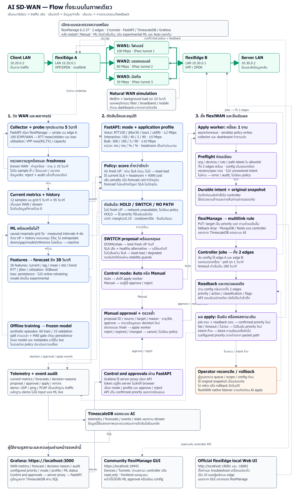

# Flow ทั้งระบบ AI SD-WAN

ภาพเดียวเชื่อม traffic จริง, natural WAN simulation, telemetry, ML forecast,
SLA policy, Auto/Manual approval, flexiManage apply/jobs/readback, audit และ GUI
ตามโค้ดของ lab ปัจจุบัน

[เปิด PNG เต็ม](../artifacts/ai-sdwan-system-flow.png) ·
[เปิด SVG เพื่อซูม](../artifacts/ai-sdwan-system-flow.svg)



เส้นหนาสีเขียวคือ traffic จริง เส้นปกติคือข้อมูลหรือคำสั่ง และเส้นประคือการตรวจสอบ
หรือ feedback

## เงื่อนไขที่ต้องอ่านคู่กับภาพ

- หลังเริ่ม live API ใหม่ ระบบเริ่ม **Manual** และปิด synthetic ML โดยค่าเริ่มต้น
  การเปิด `--experimental-synthetic-forecast` กับการเลือก Auto เป็นคนละการตั้งค่า
- Current DOWN/stale เปลี่ยนไป fresh UP ที่ดีที่สุดทันที ถ้าไม่มีเส้นผ่าน SLA
  จะเลือก least-bad และรายงาน degraded ส่วน current SLA เสียจะเปลี่ยนทันทีเมื่อมี
  alternative ที่ผ่าน SLA กรณีปกติใช้ margin/cooldown/confirmation guards
- Probe ใช้ ICMP RTT mean/stddev และ loss; jitter ในภาพเป็น RTT stddev
  Utilization ใช้ VPP byte-counter delta ของทิศทางที่ยุ่งกว่า แปลงเป็น bits/second
  แล้วเทียบ nominal capacity 100/80/30 Mbps
- Experimental ML ใช้ causal interpolation จากข้อมูลที่ได้รับแล้ว บน grid 5 วินาที
  เมื่อ measured intervals อยู่ในช่วง 4–6 วินาทีและประวัติครอบคลุม 55 วินาที
  ไม่มีการเติม down/gap หรือ extrapolation; ไม่พร้อมแล้วใช้ reactive decision
- ต้องรอ jobs และอ่าน policy กลับจาก **ทั้งสอง edges** ก่อนยืนยัน configured priority
  Native flexiWAN failover อาจเปลี่ยน packet path ก่อน AI apply ยืนยันได้
- GUI ที่ port 18443 เป็น frontend ของชุมชนในโหมด read-only ส่วน ports 18081/18082
  เป็น official local Web UI ของแต่ละ flexiEdge; Grafana ใช้ดู AI และควบคุม approvals
- Model ยังฝึกจาก synthetic data การสาธิตไม่ได้ยืนยันว่า ML ทำนาย outage ล่วงหน้า
  หรือทำงานดีกว่า reactive บนข้อมูลจริง

## สร้างภาพซ้ำ

ไฟล์ที่จัดตำแหน่งและข้อความของ PNG/SVG คือ
[`scripts/flow/render-system-flow.cjs`](../scripts/flow/render-system-flow.cjs)
ส่วน [`ai-sdwan-system-flow.mmd`](../artifacts/ai-sdwan-system-flow.mmd)
เป็น Mermaid ของ flow เดียวกัน โดยให้ renderer ของ Mermaid จัดตำแหน่งเอง
การแก้ภาพควรปรับทั้งสองไฟล์ให้เนื้อหาสอดคล้องกัน

ต้องมี Node.js 20 ขึ้นไป, Google Chrome และฟอนต์ Noto Sans Thai
(มี Tahoma เป็น fallback บน Windows) Dependencies ของ renderer ถูกตรึงใน
`scripts/flow/package-lock.json`; ไม่ต้องเปิด lab หรืออ่าน credentials เพื่อสร้างภาพ

รันจาก root ของ repository บน Windows:

```powershell
Push-Location scripts/flow
npm.cmd ci --ignore-scripts --no-audit --no-fund
npm.cmd run render
Pop-Location
```

บน Linux/macOS รัน `npm ci` และ `npm run render` ใน directory `scripts/flow`
โดยใช้ options เดียวกัน ถ้า Chrome อยู่ในตำแหน่งเฉพาะ ให้ตั้ง
`FLOW_CHROME_PATH` เป็น absolute path ของ executable ก่อนรัน renderer

คำสั่งเขียนทับเฉพาะ `artifacts/ai-sdwan-system-flow.svg` และ
`artifacts/ai-sdwan-system-flow.png` ภาพ PNG มีขนาด 3180×5340 pixels
renderer ตรวจความกว้างข้อความก่อนเขียนภาพ รูปลักษณ์อาจต่างกันตามฟอนต์และ Chrome

## โค้ดที่ใช้อ้างอิง

| ส่วนของ flow | Source |
|---|---|
| Live startup / collection | `sdwan/collector.py`, `lab/edge/probe.py` |
| History / forecast | `sdwan/features.py`, `sdwan/model.py` |
| SLA / path decision | `sdwan/domain.py`, `sdwan/policy.py` |
| Approval / asynchronous apply | `sdwan/service.py`, `sdwan/api.py` |
| Controller jobs / journal / readback | `sdwan/adapters.py`, `sdwan/flexiwan.py` |
| Telemetry and audit storage | `sdwan/storage.py` |
| Natural WAN behavior | `lab/natural_wan.py` |
| Grafana controls | `lab/grafana/control-plugin/` |
| Community / edge GUI access | `scripts/serve_community_gui.py`, `scripts/expose_official_edge_ui.py` |
