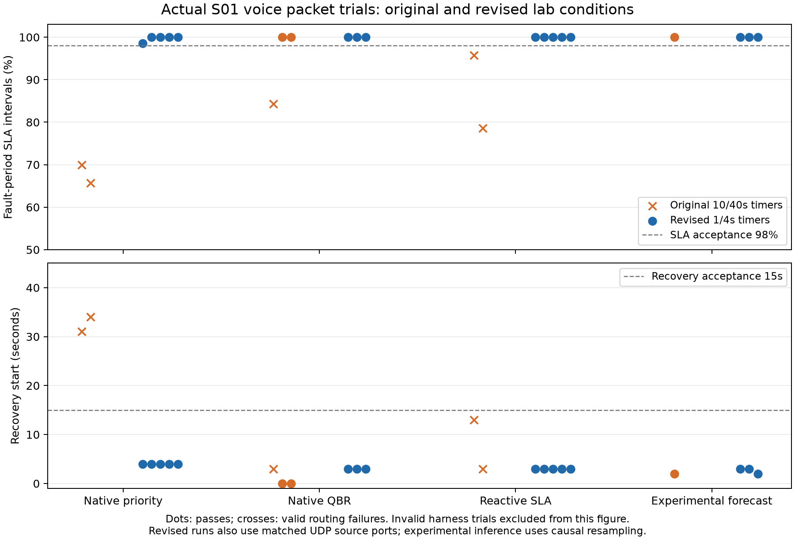

# Continued actual flexiWAN experiments — 2026-10-02

Windows hypervisor activation is complete. Two pinned KVM edges and three IPsec tunnels forward actual UDP packets. This report preserves all attempts, including the original failures and interruptions.

**43 completed packet trials; 40 valid, 33 passed. 5 harness/setup attempts are invalid and receive no success credit.**

| Experiment | Batch complete | Attempts | Packet completed | Valid | Passed | Invalid |
|---|---|---:|---:|---:|---:|---:|
| [live-smoke-20261001-01](../live-smoke-20261001-01/results.json) | True | 1 | 1 | 1 | 0 | 0 |
| [live-baselines-20261001-01](../live-baselines-20261001-01/results.json) | True | 2 | 2 | 2 | 0 | 0 |
| [live-forecast-smoke-20261001-01](../live-forecast-smoke-20261001-01/results.json) | True | 1 | 1 | 1 | 1 | 0 |
| [live-brownout-smoke-20261001-01](../live-brownout-smoke-20261001-01/results.json) | True | 1 | 1 | 1 | 1 | 0 |
| [live-s01-repeats-20261002-01](../live-s01-repeats-20261002-01/results.json) | False | 5 | 4 | 4 | 2 | 1 |
| [live-s01-tuned-20261002-01](../live-s01-tuned-20261002-01/results.json) | False | 6 | 5 | 4 | 4 | 2 |
| [live-s01-resumed-20261002-01](../live-s01-resumed-20261002-01/results.json) | True | 12 | 12 | 12 | 12 | 0 |
| [live-voice-cases-20261002-01](../live-voice-cases-20261002-01/results.json) | True | 15 | 15 | 13 | 11 | 2 |
| [live-voice-retry-20261002-01](../live-voice-retry-20261002-01/results.json) | True | 2 | 2 | 2 | 2 | 0 |

## S01 comparison after guest clock recovery

A separate batch repeats each strategy three times with fixed per-repetition UDP source ports and the same revised OSPF timers. It uses the original SLA/recovery thresholds and frozen synthetic weights.

| Strategy | Valid / attempted | Passed | SLA interval range | Recovery range |
|---|---|---:|---|---|
| Native priority | 3 / 3 | 3 | 100.0–100.0% | 4.0–4.0s |
| Native QBR | 3 / 3 | 3 | 100.0–100.0% | 3.0–3.0s |
| Reactive SLA | 3 / 3 | 3 | 100.0–100.0% | 3.0–3.0s |
| Experimental forecast | 3 / 3 | 3 | 100.0–100.0% | 2.0–3.0s |

Original 10/40-second OSPF timers kept failed-WAN routes available for tens of seconds. The revised lab uses 1/4-second tunnel timers on both edges. Source ports and experimental sampling also changed, so this is an engineering revision comparison rather than an isolated causal estimate of timer tuning.

Original QBR repeats that showed zero-second recovery already used healthy backups before WAN1 was cut. Filtered encrypted frame directions are corroborating path evidence; UDP echo receipts establish end-to-end delivery. See [original captures](../live-s01-repeats-20261002-01/path-analysis.json) and [revised captures](../live-s01-resumed-20261002-01/path-analysis.json).

## Voice coverage observations

S01 uses the three reactive repeats above; other cases use one initial reactive voice trial each. Invalid reruns are retained as additional observations with the original attempt. This does not evaluate all three application profiles or all four strategies across sixteen cases. Recovery is the first ten consecutive good seconds after fault onset; zero can mean the chosen path was unaffected or a gradual impairment had not yet breached SLA. The separate full fault-period SLA gate still applies.

| Case | Valid / observed | Passed | Recovery / no_path detection | SLA intervals |
|---|---|---:|---|---|
| S01 | 3 / 3 | 3 | 3.0–3.0s | 100.0–100.0% |
| S02 | 1 / 1 | 1 | 0.0–0.0s | 100.0–100.0% |
| S03 | 1 / 1 | 1 | 0.0–0.0s | 100.0–100.0% |
| S04 | 1 / 1 | 1 | 3.0–3.0s | 100.0–100.0% |
| S05 | 1 / 2 | 1 | 3.0–3.0s | 100.0–100.0% |
| S06 | 1 / 1 | 1 | 7.0–7.0s | 100.0–100.0% |
| S07 | 1 / 1 | 0 | 10.0–10.0s | delivery not expected |
| S08 | 1 / 2 | 1 | 4.0–4.0s | 100.0–100.0% |
| S09 | 1 / 1 | 1 | 4.0–4.0s | 100.0–100.0% |
| S10 | 1 / 1 | 1 | 3.0–3.0s | 100.0–100.0% |
| S11 | 1 / 1 | 1 | 8.0–8.0s | 100.0–100.0% |
| S12 | 1 / 1 | 0 | 12.0–12.0s | 97.1–97.1% |
| S13 | 1 / 1 | 1 | 3.0–3.0s | 100.0–100.0% |
| S14 | 1 / 1 | 1 | 4.0–4.0s | 100.0–100.0% |
| S15 | 1 / 1 | 1 | 0.0–0.0s | 100.0–100.0% |
| S16 | 1 / 1 | 1 | 9.0–9.0s | 100.0–100.0% |

Valid voice failures remain S07 and S12. S07 delivered no UDP echoes during the post-grace outage window as expected, but the first recorded API no_path observation was 10.0046 seconds after fault onset, exceeding the five-second gate. S12 recovered in twelve seconds but only 68/70 post-grace intervals passed SLA (97.14% versus the required 98%); seconds 80–81 exceeded both RTT and loss thresholds.

The initial S05 and S08 voice attempts failed healthy-baseline acceptance, despite meeting offered load. Their reruns passed with the same frozen source/weights and acceptance criteria. Both original attempts remain invalid in the table. Echoes are assigned to send-time bins, so replies near the fault boundary can straddle phases; raw packets and timestamps remain unchanged.

## Measurement and operational limits

- Windows suspend interrupted the earlier revised batch. Its forecast packet trial underdelivered and the next preflight failed. Both remain invalid. [Windows events](host-suspend-evidence-20261002.json) and [guest clock repair](clocks-after-host-resume-20261002-01.json) are retained.
- The Windows wrapper temporarily requests system activity while the experiment runs and releases it on exit. Explicit sleep/lid actions remain controlled by Windows. Runner clock/scheduling guards stop interrupted trials.
- A cold-ARP 100%-loss probe can exceed its four-second window. Incomplete measurements stay missing and age out; they are not healthy zeros. [Isolated tool diagnostic](probe-window-diagnostic-20261002.json) is separate from edge forwarding evidence.
- The initial five bring-up captures lack a defensible phase time origin. They remain preserved; derived directional phase analysis begins with the later repeat work rather than inventing timestamps.
- Experimental resampling uses only already received measurements, rejects gaps/down states and does not alter raw timestamps. The normal dashboard still disables the synthetic model.
- Frozen-model MAE diagnostics compare t+30-second recorded probes with persistence. Missing targets, unavailable RTT sentinels, correlated windows and small data scope are explicit. This is not real-data model deployment validation.
- Three repeats and voice-only coverage are exploratory. The full 576-trial smoke grid and independent real-data training/validation/held-out research evaluation remain incomplete.

Validation: 132 tests passed on Windows and Linux; Ruff check/format passed. [Windows JUnit](tests-live-continuation.xml), [Linux JUnit](linux-tests-live-continuation.xml).

Protocol and reproducible commands: [REAL_TESTBED](../../docs/REAL_TESTBED.md). Original first five packet results: [LIVE_BRINGUP](LIVE_BRINGUP.md).

## Frozen forecast diagnostic on valid trials

Valid trials provide 2207 candidate windows; 489 have an available causal history and a measured t+30-second target. Counts span three WANs and correlated windows.

| Metric | Available targets | Frozen forecast MAE | Persistence MAE |
|---|---:|---:|---:|
| latency_ms | 489 | 23.4578 | 19.3094 |
| jitter_ms | 489 | 6.9932 | 5.7908 |
| loss_pct | 489 | 0.5767 | 0.5767 |
| utilization_pct | 489 | 2.8636 | 1.4175 |

This table excludes invalid harness trials. The [full diagnostic](frozen-forecast-continuation-20261002-01.json) retains all completed trials, including invalid ones with explicit flags, and both sampling contracts. Frozen synthetic weights were not trained or promoted. This small post-hoc comparison does not establish real-data deployment readiness.
