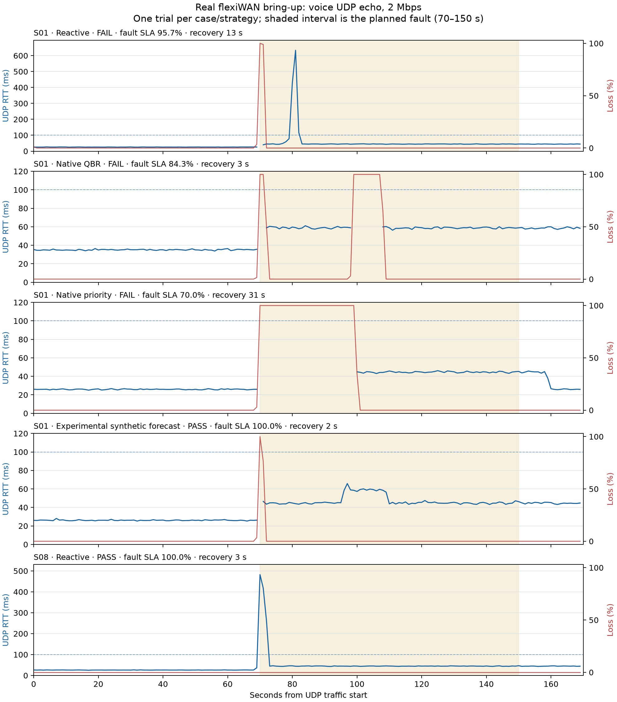

# Actual flexiWAN packet bring-up — trials recorded 2026-10-01 UTC

**Hypervisor activation and the real edge lab are operational. Five UDP/PCAP trials completed: two passed the fixed SLA criteria and three failed.** All five established a healthy baseline. This is initial voice bring-up, not a complete benchmark or real-data model validation.

The lab uses Ubuntu 24.04 WSL with KVM, two Ubuntu 20.04 flexiEdges 6.3.35 (4 GB/2 vCPU each), verified controller 6.3.37, and three WAN IPsec tunnels. The nested AMD VMs use OpenSSL crypto. Readiness and component evidence are in [post-restart-verification.json](post-restart-verification.json).

| Scenario | Strategy | Valid | Passed | Fault SLA intervals | Recovery | Raw results |
|---|---|---|---|---:|---:|---|
| S01 | Reactive | True | False | 95.7% | 13 s | [JSON](../live-smoke-20261001-01/results.json) |
| S01 | Native QBR | True | False | 84.3% | 3 s | [JSON](../live-baselines-20261001-01/results.json) |
| S01 | Native priority | True | False | 70.0% | 31 s | [JSON](../live-baselines-20261001-01/results.json) |
| S01 | Experimental synthetic forecast | True | True | 100.0% | 2 s | [JSON](../live-forecast-smoke-20261001-01/results.json) |
| S08 | Reactive | True | True | 100.0% | 3 s | [JSON](../live-brownout-smoke-20261001-01/results.json) |

S01 injects 100% loss on WAN1 in both directions. S08 increases WAN1 delay to 240 ms per direction while it remains reachable. Each trial uses 70 s baseline, 80 s fault and 20 s restoration. Offered voice load is 2 Mbps using 1,250-byte UDP echo packets. The three WAN paths have configured netem capacities of 100/80/30 Mbps; these configured limits are not measured maximum forwarding throughput.

Acceptance was unchanged: healthy baseline ≥98% good intervals, offered load ≥90% of demand, then ≥98% good fault intervals after a 10 s grace period and 10 consecutive good intervals beginning within 15 s. Voice criteria are UDP RTT ≤100 ms, RTT standard deviation ≤30 ms, loss ≤1%, and received rate ≥95% of offered traffic. RTT/stddev are proxies, not one-way latency or media jitter.

Reactive S01 delivered over WAN2 soon after the cut, but later RTT/stddev spikes at seconds 80–82 lowered the accepted interval ratio to 95.7%. Native priority had a longer outage. Native QBR initially recovered quickly but suffered another outage around seconds 99–107. These failed observations remain in the report and require repeated investigation; a recovery timestamp alone does not mean the SLA passed.

The experimental forecast loaded the frozen synthetic model and produced forecasts on all three actual WANs before fault injection. Its single S01 trial passed, as did reactive S08. One observation per strategy cannot establish an AI advantage. The model has not been retrained/validated against real training, validation and held-out datasets.

Blue: measured UDP RTT where replies arrived. Red: measured packet loss. Dashed blue: the voice RTT limit. Blank RTT during outages avoids plotting the no-reply sentinel as a measurement. [PDF figure](live-bringup.pdf).

Each experiment retains packets.json, 170 one-second intervals, states.json, per-WAN PCAP headers/wire lengths (snaplen 160), audit.sqlite3, baseline policy, apply journals and process logs. PCAP SHA-256 digests are in post-restart-verification.json. A PCAP with only its global header represents no observed data packets on that path. Public artifacts were checked for credential/private-key leakage before export; secrets/private runtime/core dumps were excluded.

**Current service:** http://127.0.0.1:8000, backend `flexiwan`, Manual/reactive, real WAN telemetry, synthetic model disabled. Configured priority was WAN2 at the final snapshot; native forwarding can choose a fallback independently. The separate dashboard evaluation section continues to label the earlier simulation results as synthetic.

**Validation:** 109 tests pass on Windows and Linux; Ruff check/format pass. The full 16 scenarios × 3 profiles × 4 strategies × 3 repeats = 576 trials (minimum 27.2 hours) has not run. Only S01/S08 and voice were observed here. Use the [runbook](../../docs/REAL_TESTBED.md) for fresh experiments and [resume instructions](RESTART_RESUME.md) after future boots.
