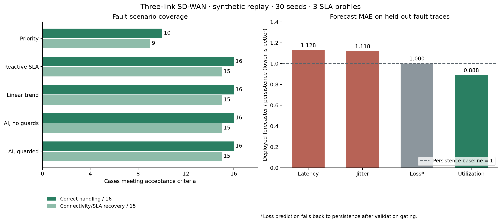

# Evaluation results

Synthetic data only. No real flexiWAN testbed was available.

30 independent seeds x 3 application profiles x 17 cases (16 faults + normal) x 5 strategies.
Total controller trials: 7650. Frozen model SHA-256: `b7b72bfa7c1f34be948b397c4aaebdc639093657c15b444992d8bef3b2bbfc7d`.

## How many scenarios can the system handle?

| Strategy | Correct handling / 16 | Connectivity/SLA recovery / 15 | Normal control |
|---|---:|---:|---|
| priority | 10 | 9 | True |
| reactive | 16 | 15 | True |
| linear_trend | 16 | 15 | True |
| predictive_unguarded | 16 | 15 | True |
| predictive | 16 | 15 | True |

S07 contributes only correct all-down handling, never connectivity recovery.

## Scenario breakdown

| Case | AI pass rate | AI | Reactive | Priority | Linear forecast |
|---|---:|---|---|---|---|
| S01 WAN1 down | 100.0% | PASS | PASS | PASS | PASS |
| S02 WAN2 down | 100.0% | PASS | PASS | PASS | PASS |
| S03 WAN3 down | 100.0% | PASS | PASS | PASS | PASS |
| S04 WAN1 + WAN2 down | 100.0% | PASS | PASS | PASS | PASS |
| S05 WAN1 + WAN3 down | 100.0% | PASS | PASS | PASS | PASS |
| S06 WAN2 + WAN3 down | 100.0% | PASS | PASS | PASS | PASS |
| S07 All links down | 100.0% | PASS | PASS | PASS | PASS |
| S08 High latency | 100.0% | PASS | PASS | FAIL | PASS |
| S09 High jitter | 100.0% | PASS | PASS | FAIL | PASS |
| S10 Packet loss | 100.0% | PASS | PASS | FAIL | PASS |
| S11 Saturation | 100.0% | PASS | PASS | FAIL | PASS |
| S12 Progressive degradation | 100.0% | PASS | PASS | FAIL | PASS |
| S13 Link flapping | 100.0% | PASS | PASS | PASS | PASS |
| S14 Concurrent mixed impairments | 100.0% | PASS | PASS | FAIL | PASS |
| S15 Missing/stale telemetry | 100.0% | PASS | PASS | PASS | PASS |
| S16 Corrupt telemetry | 100.0% | PASS | PASS | PASS | PASS |
| CONTROL Normal control | 100.0% | PASS | PASS | PASS | PASS |

## Held-out forecasting MAE

| Metric | Deployed forecaster | Persistence |
|---|---:|---:|
| latency_ms | 29.5202 | 26.1756 |
| jitter_ms | 5.9906 | 5.3581 |
| loss_pct | 2.2618 | 2.2618 |
| utilization_pct | 2.4470 | 2.7554 |

## Paired SLA difference (AI minus baseline)

CI resamples entire seeds, retaining within-seed scenario/application correlation.

- priority: +39.1113%, bootstrap 95% CI [+39.0999%, +39.1231%].
- reactive: +0.0000%, bootstrap 95% CI [+0.0000%, +0.0000%].
- linear_trend: +0.0000%, bootstrap 95% CI [+0.0000%, +0.0000%].

## Progressive degradation (S12)

Proactive means the selected path changed before WAN1 breached its SLA. Reactive quality scoring can also do this without forecasting.

| Strategy | Proactive trials | Mean lead when proactive (seconds) | Mean path changes |
|---|---:|---:|---:|
| priority | 0/90 | N/A | 0.000 |
| reactive | 90/90 | 33.67 | 1.056 |
| linear_trend | 90/90 | 37.11 | 1.056 |
| predictive_unguarded | 90/90 | 59.11 | 2.011 |
| predictive | 90/90 | 37.39 | 1.056 |

## Reading the evidence

The guarded AI and reactive SLA baseline both handle all 16 selected scenarios. This benchmark does not establish a routing/SLA advantage from ML.
The deployed forecaster uses XGBoost only for validation-approved metrics; loss falls back to persistence in this run.
Forecast metrics can deteriorate on held-out fault traces even when validation improves. Model selection is not changed after seeing evaluation results.
With 30/30 seed passes the Wilson 95% interval is approximately [88.6%, 100%], not proof of a 100% production success rate. Exact intervals are in results.json.



## Acceptance rules

```json
{
  "event_sla_attainment_min": 0.98,
  "maximum_recovery_seconds": 15,
  "unsafe_selections_after_grace": 0,
  "false_no_path_ticks": 0,
  "all_down_detection_seconds_max": 5,
  "scenario_trial_pass_rate_min": 0.95,
  "normal_control_switches_max": 2,
  "notes": "SLA measured only when a true healthy path exists; first 10s of each incident excluded from SLA/safety. All-down is safe handling, not connectivity restoration."
}
```

Policy CPU timing in trials.csv excludes ML inference and network/API delay; simulated detection resolution is 5 seconds.
Grace excludes only the first 10 seconds of an incident from SLA/safety scoring; recovery time is still reported independently.

## Limitations

- 16 is a selected fault catalogue, not an exhaustive count of three-link failures.
- No real network, controller job latency, traffic feedback, or flow/session migration is modeled.
- Available bandwidth is a capacity proxy, not measured goodput.
- Sudden faults have no guaranteed predictive precursors.
- Safety and failover gains partly come from guardrails, not from ML.
- S07 cannot restore connectivity; it only measures correct no-path detection.
- Scenario pass requires every application profile to pass for >=95% of seeds; uncertainty is resampled by seed.

Machine-readable evidence: results.json; per-trial evidence: trials.csv.
