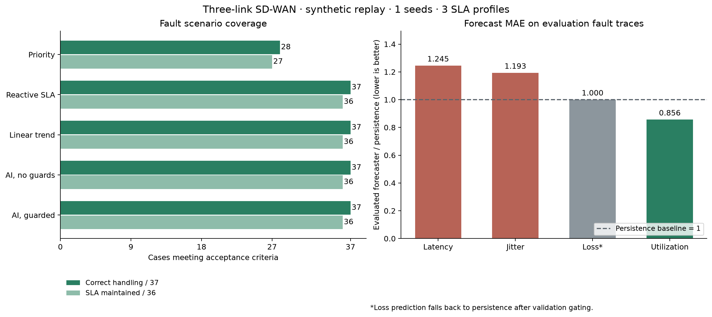

# Evaluation results

Synthetic telemetry replay. Actual packet evidence is reported separately.

1 independent seeds x 3 application profiles x 38 cases (37 faults + normal) x 5 strategies.
Total controller trials: 570. Frozen model SHA-256: `b7b72bfa7c1f34be948b397c4aaebdc639093657c15b444992d8bef3b2bbfc7d`.

## How many scenarios can the system handle?

| Strategy | Correct handling / 37 | SLA maintained / 36 | Normal control |
|---|---:|---:|---|
| priority | 28 | 27 | True |
| reactive | 37 | 36 | True |
| linear_trend | 37 | 36 | True |
| predictive_unguarded | 37 | 36 | True |
| predictive | 37 | 36 | True |

## Coverage by test group

| Strategy | Group | Passed / selected cases |
|---|---|---|
| priority | availability | 8 / 8 |
| priority | quality | 10 / 15 |
| priority | stability | 3 / 3 |
| priority | mixed | 2 / 6 |
| priority | telemetry | 6 / 6 |
| reactive | availability | 8 / 8 |
| reactive | quality | 15 / 15 |
| reactive | stability | 3 / 3 |
| reactive | mixed | 6 / 6 |
| reactive | telemetry | 6 / 6 |
| linear_trend | availability | 8 / 8 |
| linear_trend | quality | 15 / 15 |
| linear_trend | stability | 3 / 3 |
| linear_trend | mixed | 6 / 6 |
| linear_trend | telemetry | 6 / 6 |
| predictive_unguarded | availability | 8 / 8 |
| predictive_unguarded | quality | 15 / 15 |
| predictive_unguarded | stability | 3 / 3 |
| predictive_unguarded | mixed | 6 / 6 |
| predictive_unguarded | telemetry | 6 / 6 |
| predictive | availability | 8 / 8 |
| predictive | quality | 15 / 15 |
| predictive | stability | 3 / 3 |
| predictive | mixed | 6 / 6 |
| predictive | telemetry | 6 / 6 |

S07 contributes only correct all-down handling, never connectivity recovery.

## Scenario breakdown

| Case | AI pass rate | AI | Reactive | Priority | Linear forecast |
|---|---:|---|---|---|---|
| CONTROL Normal control | 100.0% | PASS | PASS | PASS | PASS |
| S01 WAN1 down | 100.0% | PASS | PASS | PASS | PASS |
| S02 WAN2 down | 100.0% | PASS | PASS | PASS | PASS |
| S03 WAN3 down | 100.0% | PASS | PASS | PASS | PASS |
| S04 WAN1 + WAN2 down | 100.0% | PASS | PASS | PASS | PASS |
| S05 WAN1 + WAN3 down | 100.0% | PASS | PASS | PASS | PASS |
| S06 WAN2 + WAN3 down | 100.0% | PASS | PASS | PASS | PASS |
| S07 All links down | 100.0% | PASS | PASS | PASS | PASS |
| S08 High latency | 100.0% | PASS | PASS | FAIL | PASS |
| S08-wan2 WAN2: High latency | 100.0% | PASS | PASS | PASS | PASS |
| S08-wan3 WAN3: High latency | 100.0% | PASS | PASS | PASS | PASS |
| S09 High jitter | 100.0% | PASS | PASS | FAIL | PASS |
| S09-wan2 WAN2: High jitter | 100.0% | PASS | PASS | PASS | PASS |
| S09-wan3 WAN3: High jitter | 100.0% | PASS | PASS | PASS | PASS |
| S10 Packet loss | 100.0% | PASS | PASS | FAIL | PASS |
| S10-wan2 WAN2: Packet loss | 100.0% | PASS | PASS | PASS | PASS |
| S10-wan3 WAN3: Packet loss | 100.0% | PASS | PASS | PASS | PASS |
| S11 Saturation | 100.0% | PASS | PASS | FAIL | PASS |
| S11-wan2 WAN2: Saturation | 100.0% | PASS | PASS | PASS | PASS |
| S11-wan3 WAN3: Saturation | 100.0% | PASS | PASS | PASS | PASS |
| S12 Progressive degradation | 100.0% | PASS | PASS | FAIL | PASS |
| S12-wan2 WAN2: Progressive degradation | 100.0% | PASS | PASS | PASS | PASS |
| S12-wan3 WAN3: Progressive degradation | 100.0% | PASS | PASS | PASS | PASS |
| S13 Link flapping | 100.0% | PASS | PASS | PASS | PASS |
| S13-wan2 WAN2: Link flapping | 100.0% | PASS | PASS | PASS | PASS |
| S13-wan3 WAN3: Link flapping | 100.0% | PASS | PASS | PASS | PASS |
| S14 Concurrent mixed impairments | 100.0% | PASS | PASS | FAIL | PASS |
| S14-wan1-wan3 WAN1 latency + WAN3 loss | 100.0% | PASS | PASS | FAIL | PASS |
| S14-wan2-wan1 WAN2 latency + WAN1 loss | 100.0% | PASS | PASS | FAIL | PASS |
| S14-wan2-wan3 WAN2 latency + WAN3 loss | 100.0% | PASS | PASS | PASS | PASS |
| S14-wan3-wan1 WAN3 latency + WAN1 loss | 100.0% | PASS | PASS | FAIL | PASS |
| S14-wan3-wan2 WAN3 latency + WAN2 loss | 100.0% | PASS | PASS | PASS | PASS |
| S15 Missing/stale telemetry | 100.0% | PASS | PASS | PASS | PASS |
| S15-wan2 WAN2: Missing/stale telemetry | 100.0% | PASS | PASS | PASS | PASS |
| S15-wan3 WAN3: Missing/stale telemetry | 100.0% | PASS | PASS | PASS | PASS |
| S16 Corrupt telemetry | 100.0% | PASS | PASS | PASS | PASS |
| S16-wan2 WAN2: Corrupt telemetry | 100.0% | PASS | PASS | PASS | PASS |
| S16-wan3 WAN3: Corrupt telemetry | 100.0% | PASS | PASS | PASS | PASS |

## Held-out forecasting MAE

| Metric | Deployed forecaster | Persistence |
|---|---:|---:|
| latency_ms | 21.8616 | 17.5599 |
| jitter_ms | 3.9678 | 3.3261 |
| loss_pct | 1.1241 | 1.1241 |
| utilization_pct | 2.2856 | 2.6695 |

## Paired SLA difference (AI minus baseline)

CI resamples entire seeds, retaining within-seed scenario/application correlation.

- priority: +24.6405%, bootstrap 95% CI [+24.6405%, +24.6405%].
- reactive: +0.0000%, bootstrap 95% CI [+0.0000%, +0.0000%].
- linear_trend: +0.0000%, bootstrap 95% CI [+0.0000%, +0.0000%].

## Progressive degradation tests

Proactive means the selected path changed before WAN1 breached its SLA. Reactive quality scoring can also do this without forecasting.

| Strategy | Proactive trials | Mean lead when proactive (seconds) | Mean path changes |
|---|---:|---:|---:|
| priority | 0/9 | N/A | 0.000 |
| reactive | 3/9 | 33.33 | 0.333 |
| linear_trend | 3/9 | 36.67 | 0.333 |
| predictive_unguarded | 3/9 | 60.00 | 0.667 |
| predictive | 3/9 | 38.33 | 0.333 |

## Reading the evidence

Read passing cases and paired differences from this run; case coverage alone does not establish a routing/SLA advantage from ML.
The evaluated forecaster uses XGBoost only for validation-approved metrics; loss falls back to persistence in this run.
Forecast metrics can deteriorate on held-out fault traces even when validation improves. Model selection is not changed after seeing evaluation results.
Wilson intervals are computed from this run's seed count. A smoke run or a perfect observed pass rate does not establish production reliability.



## Acceptance rules

```json
{
  "event_sla_attainment_min": 0.98,
  "maximum_recovery_seconds": 15,
  "unsafe_selections_after_grace": 0,
  "false_no_path_ticks": 0,
  "all_down_detection_seconds_max": 5,
  "scenario_trial_pass_rate_min": 0.95,
  "normal_control_switches_max": 2,
  "notes": "SLA measured only when a true healthy path exists; first 10s of each incident excluded from SLA/safety. All-down is safe handling, not connectivity restoration."
}
```

Policy CPU timing in trials.csv excludes ML inference and network/API delay; simulated detection resolution is 5 seconds.
Grace excludes only the first 10 seconds of an incident from SLA/safety scoring; recovery time is still reported independently.

## Limitations

- Only the 8 binary Up/Down states are exhaustive; other impairment cases are selected tests.
- Initial priority is WAN1; targeting WAN2/WAN3 also exercises standby handling, not guaranteed active-path failover.
- No real network, controller job latency, traffic feedback, or flow/session migration is modeled.
- Available bandwidth is a capacity proxy, not measured goodput.
- Sudden faults have no guaranteed predictive precursors.
- Safety and failover gains partly come from guardrails, not from ML.
- S07 cannot restore connectivity; it only measures correct no-path detection.
- Scenario pass requires every application profile to pass for >=95% of seeds; uncertainty is resampled by seed.

Machine-readable evidence: results.json; per-trial evidence: trials.csv.
